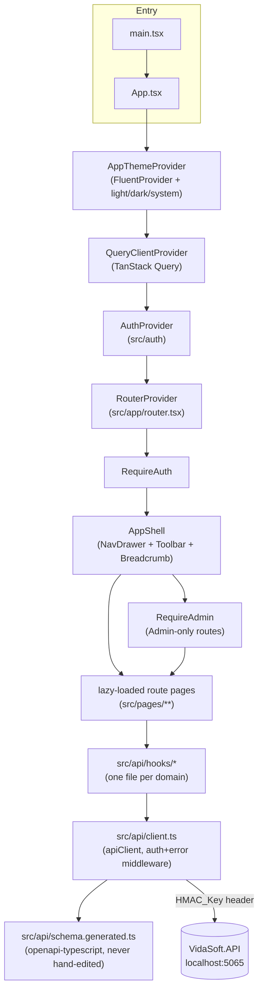
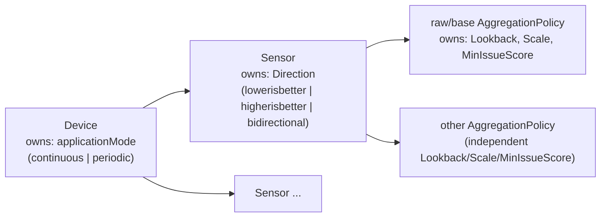

# PRECOG Dashboard — Product, Domain & Architecture

The detailed "why" behind this dashboard's behavior. `AGENTS.md` states the
rules; this file explains the reasoning; `TASK_IMPLEMENTATION.md` tracks
what's actually done. Read all three before making a structural change.

## Product purpose

PRECOG is a predictive-maintenance platform. This dashboard is its human
front end — the operational and analytical surface for the Admins and
Readers of one Company at a time. It supports:

- Operational Device and Sensor monitoring.
- Live or near-real-time Sensor monitoring (bounded polling — see §"Live
  Monitoring").
- Bounded telemetry exploration.
- Smart Analytics — historical, multi-Sensor, multi-Device analysis.
- Same-Device Sensor comparison and two-Device comparison.
- Canonical Issue management: review, categorization, grouping.
- Manual, Admin-approved knowledge sharing between Devices.
- TrainingRequest monitoring and manual retraining requests.
- ModelVersion and compatibility status where the API actually exposes it.
- Model query and its ranked similar historical Issues.
- Ollama job monitoring (submit, poll, cancel).
- Company administration: Company profile (name/logo/website), Company
  member role assignment, Reader Device-access grants, the registry of Users'
  mobile devices by MAC address (registration queue, assignments, blacklist),
  DevicePrincipal lifecycle, Locations/DeviceGroups/DeviceClasses reference
  data (including DeviceGroup membership).
- Per-Sensor maintenance mode: any level sees it, Admins switch it.
- Bulk Sensor import (Excel paste or CSV) for a Device with hundreds of Sensors.
- Per-Sensor calculation switch: store a Sensor's data without calculating from it (and, since 2026-11-19, without training the model on it).

**The old dashboard is a product-reference prototype only.** It's useful for
the workflows, visual ideas, live-monitoring instinct, and comparison
concepts it demonstrated — none of its JavaScript architecture, API calls,
state management, routing (or lack of it), CSS, hidden test functions, or
insecure behavior (a plaintext password held resident in memory to support
a silent auto-refresh loop, a hardcoded client-side backdoor password) is
preserved. See `TASK_IMPLEMENTATION.md`'s replacement matrix for the
specific old→new mapping of every feature.

## Features

The complete description of a feature is in `docs/features/<slug>.md`; read it (or run `/<slug>`) before changing that feature. Every change to a feature updates its doc file (a new feature gets a new doc file and a new skill in `.claude/skills/<slug>/SKILL.md`, and a row here and in `docs/features/README.md`). The same slug is used for the same feature in the API repository (`c:\VS\PRECOG_API\docs\features`). A cross-reference to a section by its quoted title (e.g. "see Live Monitoring") is resolved through `docs/features/README.md`, which lists the original section titles each file contains.

| Feature | Summary | Doc | Skill |
|---|---|---|---|
| Live Monitoring | Live Monitoring page: one batched read of the shown Sensors every 5 s, 429 cooldown, filter/paging/manual refresh, card charts and the enlarged chart window; the API's batched trailing read. | `docs/features/live-monitoring.md` | `/live-monitoring` |
| Smart Analytics and Sensor / Device comparison | Smart Analytics page: Single / Multi Sensor / Compare Devices modes, paged range reads, the two-Device chart with average, limits and setpoint lines, Sensor filter, enlargeable charts. | `docs/features/smart-analytics.md` | `/smart-analytics` |
| Bulk Sensor import and Sensor sheets | Import Sensors from an Excel paste or CSV (create or update, raw policy, setpoints, Calculate / Visible), the ready-made Vibration_Duo sheet, Sensor ID map and "Export sensor for hardware" (firmware sensor_map.h). | `docs/features/sensor-import.md` | `/sensor-import` |
| Sensor unit catalog, SensorType and Sensor type suggestions | The API's unit catalog and the 163 Vibration_Duo metrics (GET /api/SensorMetadata), the removed aggregation type / explanation, the QuantityKind -> SensorType rename, the Data sets workbook and the Sensor type dropdown. | `docs/features/sensor-metadata.md` | `/sensor-metadata` |
| Sensor maintenance mode, maintenance history and baselines | Per-Sensor and Device-wide maintenance mode (data accepted but ignored), the maintenance history with kind (Replacement / Minor), baseline segments with warm-up, kind change and manual baseline, chart markers. | `docs/features/maintenance.md` | `/maintenance` |
| Per-Sensor calculation switch | Sensor.ProcessingEnabled: store a Sensor's data without calculating from it (and, since 2026-11-19, without training on it); switching on runs a catch-up; Recalc with calculation off only deletes. | `docs/features/calculation-switch.md` | `/calculation-switch` |
| Per-Sensor visible switch | Sensor.Visible: a presentation-only flag that hides a Sensor from Live Monitoring and Smart Analytics; everything else still shows it. | `docs/features/visible-switch.md` | `/visible-switch` |
| Control limits (UCL / LCL) | UCL3 / UCL2 / LCL2 / LCL3 are calculated by the API when read (2026-11-18), not stored; the history of the stored limits and the analysis loop fixes. | `docs/features/control-limits.md` | `/control-limits` |
| Aggregation levels, aggregation engine and Device time zone | Aggregation levels per Sensor: the engine (buckets, 21 functions, late data), bulk create / CSV, time scales, Device time zone, minimum evaluation, evaluation of levels like Sensors (anomalies, Issues), per-level calculation switch, aggregation pickers on the charts. | `docs/features/aggregation.md` | `/aggregation` |
| Setpoints (target / tolerance intervals) | Setpoint intervals: Manage Setpoints export / import as the complete truth, deleting intervals, the setpoint columns of "Export all sensors"; the API's delete endpoint and Device-wide setpoint / policy listings. | `docs/features/setpoints.md` | `/setpoints` |
| Issues: canonical grouping, review state, categories, feedback text, deletion | Issues: canonical grouping (group / ungroup / move / reassign), review states, the Company category catalog and Ollama suggestions, the editable feedback text, Issue continuity across analysis batches, permanent deletion. | `docs/features/issues.md` | `/issues` |
| Knowledge sharing between Devices | Admin-approved, versioned source-to-target knowledge sharing: compatibility proof, draft, approval with 100 % coverage, Issue selection; the target retrains its own model. | `docs/features/knowledge-sharing.md` | `/knowledge-sharing` |
| Training, retraining and models | TrainingRequests and models: one lineage per Device, retraining generation and coalescing, the eligible training set, the shared pipeline version, calculation-off Sensors out of the model, end-to-end verification. | `docs/features/training.md` | `/training` |
| Ollama jobs | Ollama summary jobs: asynchronous submit / poll / cancel, the real terminal status "Succeeded", advisory output rendered as text. | `docs/features/ollama.md` | `/ollama` |
| Two languages (English / Hungarian) and the Issue text translation | English / Hungarian UI (t() keys, translation files, language switch) and the Issue text stored in both languages, translated by Ollama five minutes after the last change. | `docs/features/languages.md` | `/languages` |
| Indicator (Sensor) descriptions | Markdown description texts per Sensor in English and Hungarian: edited in the Sensor dialog, imported / exported / removed for a Device, shown on the enlarged chart and in Smart Analytics. | `docs/features/descriptions.md` | `/descriptions` |
| Permanent Device deletion and "Delete all data" | Permanent deletion of a Device and the lighter "Delete all data" (telemetry, Issues, models; settings kept), both confirmed by typing the Device name. | `docs/features/device-deletion.md` | `/device-deletion` |
| Logs: activity log and system log | Admin-only Logs: the activity (audit) log and the system log, newest 30 first, filters, paging; the API's bounded, Company-scoped log reads. | `docs/features/audit-logs.md` | `/audit-logs` |
| Mobile-device MAC address registry | The Company's registry of Users' phone MAC addresses (queue, registered, blacklist), managed by Admins; Devices can only queue, resolve a role and read the latest Issue text. | `docs/features/mac-registry.md` | `/mac-registry` |
| Company profile and human User synchronization | Company profile (name / logo / website, profileSource, nameEditable), Users without an authorized Company, and the human User / Company synchronization from the WordPress mirror or Entra ID. | `docs/features/company-identity.md` | `/company-identity` |
| Platform administrator, invitations and password reset | The env-configured platform account (VSSSysAdmin): creating Companies, inviting the first Admin by e-mail, single-use invitation and password-reset links, the last-Admin rule, the e-mail and Dashboard address settings. | `docs/features/platform-admin.md` | `/platform-admin` |
| DevicePrincipal ids next to the Secret | The DevicePrincipal page shows the Principal ID and Device ID (copyable, not secret) permanently and next to the one-time Secret. | `docs/features/device-principal.md` | `/device-principal` |
| Session expiry: sign in again in place | A 401 never throws the user out: the access is marked expired and a dialog asks for the password over the current page, then failed queries are refetched. | `docs/features/session-expiry.md` | `/session-expiry` |

API-only features (doc and skill only in c:\VS\PRECOG_API): `recalculation` (Recalculation and catch-up), `telemetry-ingestion` (Signal ingestion and the derived Period), `device-heartbeat` (Device activity and liveness (HeartBeat)), `issue-email` (Issue e-mail notifications).

## Frontend architecture



### Folder structure

```text
src/
  index.css               the one global stylesheet - resets the browser's
                           default body margin (Fluent scopes itself to its
                           own tree and never resets the page shell around
                           it) plus a global border-box default; imported
                           once from main.tsx
  api/
    client.ts            centralized apiClient + auth/error/cancellation middleware
    errors.ts             normalizeApiError - the 3 real error-body shapes
    domainTypes.ts        hand-typed shapes the live OpenAPI doc leaves undocumented
    authHeaderPatch.ts     type-only patch for the generated schema's HMAC_Key quirk
    queryClient.ts        TanStack Query client + retry/backoff policy
    queryKeys.ts           one query-key factory, so invalidation can't drift
    schema.generated.ts    generated - regenerate with `npm run gen:api`, never hand-edit
    hooks/                 one file per API domain (devices, sensors, issues, ...)
  auth/
    authStore.ts           framework-agnostic in-memory session store
    AuthContext.tsx        React context wrapping authStore + GetUserDetails
    RequireAuth.tsx         route guard - no session -> /login
    RequireAdmin.tsx        route guard - not Admin -> in-page NotAuthorizedState
  app/
    router.tsx              route table, every route lazy-loaded
    AppShell.tsx             NavDrawer/Toolbar/Breadcrumb/theme menu
    navConfig.ts             single source of truth for nav items + route table
  theme/
    theme.ts                 PRECOG-blue-derived Fluent brand ramp
    ThemeContext.tsx          light/dark/system, persisted locally
  components/
    PageHeader.tsx, StatusPill.tsx (incl. MaintenancePill), DateTimeField.tsx
    charts/TelemetryChart.tsx, palette.ts
    states/LoadingState.tsx, EmptyState.tsx, ErrorState.tsx, NotAuthorizedState.tsx
  lib/
    dateTime.ts, downloadFile.ts, macAddress.ts, sensorImport.ts, pollIntervals.ts, useMediaQuery.ts, useNumberSearchParam.ts, usePageVisible.ts
  pages/
    one folder per domain, one file per route (see TASK_IMPLEMENTATION.md's route matrix)
  test/
    setup.ts
```

### Route architecture

`src/app/router.tsx` uses React Router 7's data-router `lazy` field on every
route below `/login`, so each page ships as its own build chunk (verified —
see `TASK_IMPLEMENTATION.md`'s test/verification matrix). `navConfig.ts` is
the single source shared by the `NavDrawer` and, implicitly, the route
table, so nav visibility and routing can't drift apart.

### Theme system

`src/theme/theme.ts` derives a 16-step Fluent brand ramp from the existing
PRECOG blues (`#014F91`/`#0077CB`) via `createLightTheme`/`createDarkTheme`,
so the rebrand reads as continuation, not reset. `ThemeContext.tsx` tracks a
`light | dark | system` preference in `localStorage` (a harmless local UI
default, never anything auth-related — see AGENTS.md's persistence rules)
and a live `matchMedia('(prefers-color-scheme: dark)')` listener for the
`system` case.

### Responsive application shell

`AppShell.tsx`'s `NavDrawer` is `type="inline"` (persistent) at desktop
widths and `type="overlay"` (triggered by a `Hamburger`) below 1200px, using
`useBreakpoint()` (a real `matchMedia`-backed hook, not a guessed width).
`DeviceListPage.tsx` demonstrates the DataGrid-desktop / card-list-mobile
pattern that other dense-table pages should follow as they're built out.
`SmartAnalyticsPage.tsx`'s single-Device overlay layout and its two-Device
incompatible-comparison side-by-side panels (since replaced by one shared chart, see "Sensor and Device comparison") are a second reference
instance of the same pattern (`useBreakpoint() === 'desktop'` switches
between a multi-column grid and a stacked single column) — both were
originally built with a mobile-layout style defined but never actually
applied (`layoutMobile` sat unused; the desktop grid rendered
unconditionally at every width), found via a real vertical-overflow defect
report and fixed by wiring the existing style to the breakpoint rather than
inventing a new one.

**Vertical overflow root cause, fixed once, globally**: every page had an
unwanted browser-level vertical scrollbar even on content that should fit
the viewport. The cause was not any one page's layout - it was the
browser's own default `body { margin: 8px }` user-agent rule, never reset
anywhere in this app (Fluent's `FluentProvider` and Griffel-generated
component styles deliberately never touch the page shell around them, by
design, so they can be dropped into any host page). That 16px (8px top +
8px bottom) pushed every page's document height 16px past the viewport,
on every route, regardless of content. Fixed once, centrally, in
`src/index.css` (`html, body { margin: 0 }` plus a `#root { height: 100% }`
chain matching the `minHeight: '100vh'` flex layouts already in
`ThemeContext.tsx`/`AppShell.tsx`) — not by hiding overflow with
`overflow-y: hidden` on any container, which would suppress genuinely
overflowing content instead of fixing the actual cause. Confirmed via
direct layout inspection (`document.documentElement.scrollHeight` exactly
matched `window.innerHeight` after the fix, at every viewport, on every
page, versus a uniform +16px before it) and via the two page-specific
layout bugs above, which the same investigation surfaced. Content-dense
pages (Smart Analytics' chart-plus-two-cards column, a phone-width Device
detail page) can still legitimately need to scroll on a narrow viewport —
that is expected, normal responsive behavior, not this defect, and is not
"fixed" by removing real content.

### Generated OpenAPI types and their ownership

`npm run gen:api` runs `openapi-typescript` against the live
`http://localhost:5065/swagger/v1/swagger.json` and writes
`src/api/schema.generated.ts`. That file is never hand-edited — full stop.
Two gaps in what it can express are handled outside it, never by editing it:

1. **The `HMAC_Key` header is typed as a required call-site parameter** on
   every operation (Swashbuckle emitted it as an explicit header parameter
   for the custom `[ValidateHMAC]` attribute, not just via
   `securitySchemes`), even though `client.ts`'s middleware injects it
   centrally. `authHeaderPatch.ts` is a shallow, non-invasive mapped type
   (`AuthPatchedPaths`) that strips just that one requirement from the type
   `createClient<T>()` is instantiated with — it never touches the
   generated file itself, and it doesn't touch request/response body types.
2. **Some response shapes are undocumented in the live OpenAPI document
   itself** (prose-only descriptions, no schema) — the two Authentication
   endpoints and the four telemetry-ingestion `202` bodies. `domainTypes.ts`
   hand-types the ones this frontend actually consumes, each with a comment
   citing the gap, confirmed against backend source by the modernization
   audit's deep-dive pass (see that document's discrepancies D1/D5–D7).
   `User_GetUserDetails` (discrepancy D3) is no longer in this category — a
   live-contract refresh made it a fully documented, generated
   `CurrentUserDto`; `AuthContext.tsx` imports that type directly and the
   hand-typed `UserDetails` workaround was removed once it did.

### Centralized `openapi-fetch` wrapper (`src/api/client.ts`)

One `apiClient` instance, one `authMiddleware`:

- **Base URL** from `VITE_API_BASE_URL` — throws at import time if unset.
- **Auth header** — `onRequest` reads the current token from `authStore` and
  sets `HMAC_Key`. No call site ever sets it itself.
- **Error normalization** (`errors.ts`) — `onResponse` on a non-2xx clones
  the response, classifies the body into one of the three real shapes this
  API actually returns (plain string / ad-hoc `{Message|message}` object /
  genuine `ValidationProblemDetails` from automatic model-binding failure —
  **never** assume the uniform `ProblemDetails` envelope the integration
  guide claims; the running API has no such middleware, confirmed against
  `Program.cs`), and throws a typed `ApiError`.
- **401** — `notifyUnauthorized()` marks the access as expired centrally; the
  sign-in dialog (`SessionExpiredDialog`) reacts via `useSyncExternalStore`
  and the page stays where it is.
- **403/404/409** — left on `ApiError.status` for the call site to render
  the page-appropriate state.
- **429** — `ApiError.retryAfterSeconds` from the `Retry-After` header;
  `queryClient.ts`'s retry policy waits exactly that long, once, before
  giving up.
- **Correlation ID** — opportunistically read from `X-Correlation-Id`/
  `X-Request-Id` response headers (none of the current operations emit one
  over HTTP — the one real correlation surface today is
  `OllamaJobDto.correlationId` in the body itself, per the Deployment
  Runbook's "safe cross-referencing points for support/debugging" guidance;
  the Ollama Jobs page should — and the header hook already can, once one
  exists — surface both).
- **Network failure** — a separate `onError` hook, since `fetch()` itself
  throws before any `Response` exists for offline/DNS/CORS/connection-refused
  failures; normalized into the same `ApiError` shape with `status: 0`.
- **Cancellation** — every hook forwards TanStack Query's `signal` into the
  underlying call.
- **204 No Content** — `unwrap()` (the thin `{data,error}` -> real-value/throw
  wrapper every hook calls) treats a `204` response as a legitimate,
  data-less success, never an error. `openapi-fetch` itself returns
  `data: undefined` for *any* 204 regardless of what the server actually
  sent, which is indistinguishable at the type level from the "something
  went wrong and there's no data" case `unwrap()` also has to catch — a real
  bug (found and fixed via mocked-browser verification, not a hypothetical)
  that would have silently broken every 204-returning mutation in this app
  (Company role assign/revoke, Device-grant revoke, DevicePrincipal
  revoke/enable, aggregation-policy deactivate, DeviceGroup membership, and
  more) had it shipped. See `TASK_IMPLEMENTATION.md`'s decision log #23 for
  the full incident.

### TanStack Query conventions

- **Query keys** — one factory, `src/api/queryKeys.ts`. A hook never
  hand-writes an array key inline, so a mutation's `invalidateQueries` can't
  silently drift out of sync with the query it's meant to invalidate.
- **Invalidation** — each mutation hook invalidates exactly the query keys
  its own operation is documented to affect (e.g. `useUpdateDevice`
  invalidates both `queryKeys.device(id)` — via `setQueryData` for an
  instant update — and `queryKeys.devices`, since the list view also shows
  the changed field).
- **Mutations** — `useMutation` throughout; no page manages its own loading/
  error boolean by hand.
- **Cancellation** — see above; this is what makes "no duplicate active
  request for the same query" and "cancel obsolete requests" true for free.
- **Polling lifecycle** — see `src/lib/pollIntervals.ts` (the single place
  every interval is defined) and the Live Monitoring / Training / Ollama
  sections below for exactly which query polls, at what interval, and what
  stops it.
- **Device detail heartbeat** — `useDevice` takes an optional
  `refetchIntervalMs` and defaults to no polling, so only Device detail opts
  in, at `POLL_INTERVALS_MS.deviceDetail` (30 s). It is needed because the
  global defaults are `staleTime: 15_000` with `refetchOnWindowFocus: false`:
  without it, a page left open would hold its first response indefinitely and a
  healthy, actively reporting Device would appear to age — which reads as a dead
  Device. `GET /api/Devices/{deviceId}` has no named rate-limit policy, so this
  does not consume the `LargeTelemetryRead` budget Live Monitoring depends on.

### Authentication/session architecture

See "Authentication and security" below for the full explanation — in
short, `authStore.ts` is a plain closure-based store (token, principal type,
expiry) with no persistence, wrapped by `AuthContext.tsx` for component
consumption via `useSyncExternalStore`.

### Error normalization

Covered above under the client wrapper — this is the one place in the
codebase that has to know the API's real (not documented) error shapes.

### Forms and validation

Fluent `Field`/`Input`/`Select`/`Textarea` throughout, with inline
`validationState`/`validationMessage` for client-side checks (e.g.
`DateTimeField`'s start-before-end validation). Server-side validation
failures surface through the same `ErrorState`/`ApiError.fieldErrors` path
as every other error, not a separate form-error system.

### Shared components

`PageHeader`, `StatusPill` (four variants: `FreshnessPill`,
`ReviewStatePill`, `JobStatusPill`, `EnabledPill` — every one pairs a color
with a distinct icon and a text label, never color alone), `DateTimeField`,
the five request-state components (`LoadingState`/`EmptyState`/
`ErrorState`/`NotAuthorizedState`/`NoCompanyState` — the last added for the
`hasAuthorizedCompany: false` case, see "Company profile and mirrored
identity" below), `ConfirmDialog` (the one reusable
confirm/consequential-action dialog — normal or destructive intent, busy
and confirm-disabled states — every page that needs a confirmation uses
this instead of `window.confirm`), `MoveToCanonicalDialog` (built on top of
`ConfirmDialog`, adds the bounded searchable candidate picker described
above), `AppToastProvider`/`useAppToast` (the centralized Fluent Toast
layer — see "Notifications" below), and `isSafeHttpsUrl`
(`src/lib/safeExternalUrl.ts` — the one shared https-only scheme check for
untrusted external text, currently the Company `logo`/`website` fields; see
"Company profile and mirrored identity" below).

### Notifications

A single Fluent Toast layer (`src/components/ToastProvider.tsx`) is the
only in-app notification mechanism — no native `alert`, no
`react-toastify`/`react-desktop-notification` (both removed from the old
dashboard, not reintroduced). `useAppToast()` is called from a mutation's
`onSuccess` at the page level for event feedback that matters beyond the
current view: a save succeeded, a review verdict was recorded, a category
was assigned/accepted/rejected, retraining was requested, a grouping
mutation completed, a DevicePrincipal credential was provisioned/rotated/
revoked/enabled/disabled, a knowledge share was approved/revoked, an Ollama
job was submitted/succeeded/failed/cancelled. A toast never duplicates a
field-level validation error, which stays next to the control that
produced it via the existing `ErrorState`/`Field` `validationMessage` path
— the two are deliberately not the same mechanism. A toast body is always a
short, human-written string, never a raw response body, a token, a Device
Secret, or unfiltered Ollama output. Because `queryClient.ts`'s
`QueryClient` is a module-level singleton created outside React, it can't
call `useAppToast()` directly — `src/components/toastBridge.ts` is a
second bridge module (same closure-registration pattern as
`authStore.ts`), letting the query client's global `onError` handlers
(network failure, 429 with the server's `Retry-After` value) surface a
toast without every call site needing to know about toasts. 401 is
deliberately not toasted globally — the redirect to `/login` is feedback
enough — and 400/403/404/409 stay inline at the call site
(`ErrorState`/field validation) rather than being duplicated as a toast.
Browser desktop notifications remain a future enhancement, not built this
pass.

### Visualization components

`src/components/charts/TelemetryChart.tsx` is the single chart component
behind Live Monitoring, Smart Analytics, Device/Sensor comparison, and the
Issue-detail telemetry view — replacing the old dashboard's three
independently copy-pasted (and buggy — a literal duplicate object key)
chart components. It normalizes all four telemetry families
(`src/api/hooks/telemetry.ts`'s `TelemetryPoint`) into one shape, supports
`mode="single"` (control-limit/target bands, anomaly-tinted points) and
`mode="compare"` (clean multi-series overlay, one color + one line-dash
pattern per series so color is never the only distinguishing signal), and
always renders a generated text summary alongside the visual.

### Test architecture

Vitest + React Testing Library, `jsdom` environment (pinned to `25.0.0` —
newer versions currently ship a broken transitive ESM/CJS interop chain via
`html-encoding-sniffer` → `@exodus/bytes`, an upstream bug unrelated to this
project), `vmThreads` pool (Fluent UI's CJS `tabster` dependency fails to
resolve at all under plain `threads` once a test renders a real Fluent
component, e.g. any `Dialog`; several of `vite.config.ts`'s
`deps.optimizer`/`server.deps.inline` options that fix this only take
effect under `vmThreads` — confirmed the whole suite still passes under it,
so it doesn't reintroduce the original `forks`→`threads` jsdom issue), and
one stable `fetch` mock installed in `src/test/setup.ts`
(`src/test/mockFetch.ts` reconfigures it per test — `openapi-fetch`
captures `globalThis.fetch` once at first import of `client.ts`, so a
per-test `vi.stubGlobal` is too late to matter). `@axe-core/playwright` +
`@playwright/test` are also devDependencies, used for the one-off
mocked-browser responsive/accessibility verification pass described above
and in `TASK_IMPLEMENTATION.md` — not part of the `npm test` unit-test run.
See `TASK_IMPLEMENTATION.md`'s test matrix for current coverage and gaps.

### Environment configuration

`VITE_API_BASE_URL` is the only environment variable this app reads.
`.env.example` documents it with a placeholder; `.env` (gitignored)
holds the real value for local development against the Dockerized API.

### Performance constraints

- Every list read is bounded (`take`/`skip`, capped Sensor-overlay count; a paged
  telemetry range stops at 20,000 readings per series).
- No ML/anomaly/similarity/`GetElbow` computation happens in the browser —
  see AGENTS.md's rule; every such value is rendered directly from an API
  response.
- Polling is centrally defined (`pollIntervals.ts`) and stops on a terminal
  status where one exists. Every interval query pauses in a backgrounded
  tab — TanStack Query's `refetchIntervalInBackground` defaults to `false`
  for all of them, gating actual execution on window focus. Live Monitoring
  additionally uses `usePageVisible()` explicitly, not to duplicate that
  pause (redundant with the library default) but to drive its own visible
  "Paused - tab not visible" UI text and its manual live/paused toggle.
- Route-level code splitting keeps the initial bundle from growing with
  every new page.

## Backend concepts reflected by the dashboard

### Tenant and roles

Company is the tenant boundary — every resource this dashboard shows is
scoped to the caller's one authorized Company; there is no cross-Company
browsing anywhere in the API, so none exists in the UI either. Admin is
Company-scoped (sees every Device in the Company). Reader is read-only and
sees **only** Devices explicitly granted through the direct
`UserDeviceGrant` model (plus group/location-derived access, surfaced via
`EffectiveAccess`) — Reader access is never inferred from Company membership
alone, and the frontend never renders a mutation control for a Reader, not
even a disabled one (`RequireAdmin`, and the `isAdmin` check repeated at
every individual mutation control). DevicePrincipal is a machine identity,
architecturally unrelated to human roles — see "Authentication and
security."

**"Managing Reader Users" covers both role assignment and Device-access
grants — the two are separate capabilities, both now built.**
`ReadersPage.tsx` answers both: a "Company members" section (Admin/Reader
role assignment, `useCompanyMembers`/`useAssignCompanyRole`/
`useRevokeCompanyRole`) above the original per-Device grant/revoke panel
(plus a read-only view of each Reader's group/location-derived effective
access). The role-assignment section was left deliberately unbuilt through
an earlier checkpoint — two explanations were equally plausible and neither
this dashboard's own decision log nor the backend's documentation settled
which was true on its own: a genuine missing page, or (in a
`MirroredDatabase`-identity deployment — see "Company profile and mirrored
identity" below) role intended to flow one-way from the WordPress source of
truth, which would make an in-dashboard control actively wrong for that
deployment mode even though the API accepts it unconditionally. Resolved,
not left open: the mutation controls (per-member Admin/Reader checkboxes)
render only when `CompanyDto.profileSource === 'Local'` — exactly the same
signal `nameEditable` already uses for the same reason — and a
`MirroredDatabase` Company instead shows members read-only with an inline
explanation that role comes from the WordPress sync. This is directly
supported by the backend's own documentation, not guessed: its EntraId
section states "New synchronized Users must receive no effective Device
access until an authorized Admin assigns the Reader role and explicit
Device grants," implying the assignment action is genuinely expected for a
locally-managed Company, while its mirrored-permission section is explicit
that WordPress `permissionlevel` sync is the sole source of truth there.
Confirmed against the old dashboard's Git history (again, no predecessor to
recover either way — neither its `Header.jsx` nor any surviving component
ever managed who held the Reader role at all).

### Device and Sensor configuration



This is the single biggest structural break from the old dashboard, which
put Direction/Lookback/Scale/MinIssueScore directly on the Device. Each is
now owned at a different level, and **editing one aggregation level's
Lookback/Scale/MinIssueScore never touches another level's** —
`SensorPoliciesPage.tsx` edits exactly one `SensorAggregationPolicyDto` at a
time, keyed by its own `id`.

`MinIssueScore` affects Issue *qualification* only (the inclusive threshold
a possible Issue's score must clear before it's a real Issue) — it is
explicitly **not** training-defining data, and changing it alone never
retrains or invalidates a model. `Lookback`/`Scale` may affect feature
construction and model compatibility, so `SensorPoliciesPage.tsx`'s
retraining-impact warning fires only when the **raw** policy's Lookback,
Scale, or Enabled state changes — never for a MinIssueScore-only edit, and
never for a non-raw aggregation level.

**Sensor creation and editing** live on `DeviceDetailPage.tsx` (an "Add
Sensor" action in the Sensors section header, and a per-row "Edit" action),
Admin-only, via `useCreateSensor`/`useUpdateSensor`. This closed a real gap
found during a full source assessment: the hooks existed, correctly typed
against `CreateSensorRequest`/`UpdateSensorRequest`, from early in the
rewrite, but no page ever called them — `DeviceDetailPage.tsx`'s own
empty-state copy ("Add a Sensor to start collecting telemetry") promised an
action that didn't exist. `CreateSensorRequest` creates the Sensor's
raw/base `AggregationPolicy` in the same call (`rawScale`/`rawLookback` are
required) — every other aggregation level is still added later from the
Sensor's own Policies page, which is unaffected. `isCurve` (whether this
Sensor's telemetry lands in curves/bicurves vs. signals/bisignals) is
derived from the parent Device's `applicationMode` and never exposed as a
free choice in the create form — a Sensor whose curve/signal storage
disagreed with its own Device's mode would be a self-inconsistent state
nothing else in this app expects. The old dashboard has no equivalent
workflow to reference here: its own Device add/edit dialog put
Direction/Lookback/Scale/MinIssueScore directly on the Device (the "obsolete
assumption" the whole per-aggregation-level model above replaces), with no
separate per-Sensor entity at all — this UI was designed fresh against the
current API contract, informed only by that dialog's general shape (a
modal form with Cancel/Create actions), not its field set.

### Telemetry

Four families — Signal (continuous, unidirectional), Curve (periodic,
unidirectional), BiSignal (continuous, bidirectional), BiCurve (periodic,
bidirectional) — see `src/api/hooks/telemetry.ts`'s `TelemetryFamily` union
and `familyFor()`, which derives the family from `Device.applicationMode` +
`Sensor.direction` (never guessed from a Device-level field, since
`Direction` no longer exists there).

`SensorId` is present in every ingestion request-body item — this frontend
doesn't build an ingestion UI (see AGENTS.md), but every *read* hook passes
`sensorId` as a query parameter, since a single-Sensor read is correctly not
a batch. Every date-range/period-range read is bounded (`take`, plus the
server's own `MaxQueryRangeDays`/`MaxPageSize` clamps) — nothing in this
frontend requests an unbounded telemetry range.

Authoritative anomaly/target/tolerance/control-limit calculation happens
entirely server-side; the frontend only renders `TelemetryPoint` fields as
returned.

**A Signal's `period` is derived, not stored (API change 2026-10-28).** For the
Signal family the API no longer has a stored period: `SignalOutputData.period` is
the `measured` instant as Unix epoch **milliseconds**, computed by the API, and
`LastPeriod`/`PeriodRange` speak the same scale. The Dashboard never ingests
(so the now optional, ignored `SignalInputData.period` and the removed 409 of
`POST /api/Continuous/Signals` change nothing here - `schema.generated.ts` was
regenerated for them) and keeps reading `measured` for time axes and `period`
only as an opaque, ordered identifier; it must never be shown as a sequence
number or compared across Sensors. BiSignal, Curve and BiCurve keep their
client-supplied Period.

## Authentication and security

- Human sign-in: `POST /api/Authentication/Request_HMAC_Key`. The response
  (`{_HMAC_Key}`) has no schema in the live OpenAPI document (prose only) —
  `domainTypes.ts`'s `HmacKeyResponse` is hand-typed from source.
- **Token storage decision**: memory-only, in `authStore.ts`'s closure.
  Never localStorage/sessionStorage/a cookie. A page refresh always requires
  re-authentication — a deliberate carry-over from the old dashboard's one
  correct security property.
- **Token expiry**: the API doesn't return an expiry in the login response,
  so the frontend assumes the documented 900s default for UI purposes
  (`ASSUMED_TOKEN_LIFETIME_SECONDS` in `AuthContext.tsx`) while the *actual*
  enforcement is entirely server-side, caught by the global 401 handler.
- **No silent reauthentication loop.** The old dashboard held the plaintext
  password resident in React state for the whole session specifically to
  support a 14m30s auto-refresh `setInterval`. This dashboard does not do
  that, anywhere. A 401 from any call, on any page, does **not** sign the
  user out and does not redirect: `notifyUnauthorized` marks the access as
  expired (`isReauthRequired`) and `SessionExpiredDialog` asks for the password
  again **over the current page** (see "Session expiry: sign in again in
  place" below). Signing out (or closing the tab) is what ends the session.
- **Logout**: clears the in-memory session; nothing to invalidate
  server-side beyond the token's own natural expiry (there's no logout/
  revoke-token endpoint).
- **One-time Device Secret**: see "Security rules" in `AGENTS.md` — held
  only in `DevicePrincipalPage.tsx`'s local dialog state, copy button +
  persistent warning, discarded on close.
- **Rotation/revocation**: `useRotateDevicePrincipalCredential`/
  `useRevokeDevicePrincipalCredential` — both take effect immediately
  against the database (the API re-validates on every request, not just
  signature validity), even against an already-issued unexpired token.
- **Safe rendering**: covered above under "no raw HTML."
- **Environment variables**: `VITE_API_BASE_URL` only, documented in
  `.env.example` with no real value; `.env` is gitignored.
- **No secret persistence** anywhere this dashboard controls.

## Accessibility and responsiveness

- Keyboard navigation, focus management, and dialog focus restoration come
  from Fluent's primitives (`Dialog`, `Drawer`, `Menu`, `DataGrid`) — built
  in, not re-implemented.
- Status is never color-only: every `StatusPill` variant pairs a color with
  a distinct icon shape and a text label.
- Every click-to-navigate `Card`/`div` (as opposed to a real `<Button>`) is
  keyboard-operable via the shared `activateProps()` helper
  (`src/lib/useActivateProps.ts`) — `role="button"`, `tabIndex={0}`, and
  Enter/Space activation. `DeviceListPage`'s `DataGrid` row gets a keyboard
  handler instead (Fluent's `DataGrid` already provides its own grid-level
  ARIA semantics; adding a conflicting `role` would be wrong there).
- Charts carry a generated text summary (`TelemetryChart`'s summary line)
  alongside the visual, for a screen-reader user or anyone who wants the
  numbers without reading a chart.
- `prefers-reduced-motion` is respected in the chart's animation config.
- Responsive: verified, not just built-and-reasoned-through — every
  authenticated route (17 pages) plus `/login` was opened in a real
  Chromium browser (Playwright, network-mocked backend) at four
  representative widths (1920×1080, 1366×800, 834×1112, 390×844) and
  checked for horizontal overflow. Zero overflow failures across all
  17×4 combinations checked. See `TASK_IMPLEMENTATION.md`'s Phase 22 and
  "Mocked-browser verification methodology" section for exact scope and
  the two real layout bugs this pass found and fixed (an invalid
  breadcrumb `<li>` nesting, a `setState`-during-render warning).
- An automated accessibility audit (`@axe-core/playwright`) was run
  against 18 page-states in that same session (every top-level route, the
  DevicePrincipal Secret-reveal dialog opened, Issue detail). Concrete
  issues found and fixed: every page was missing a semantic `<h1>`
  (Fluent's `Title2`/`Title1` need the `as` prop — visual size and
  semantic heading level are decoupled by design in Fluent v9), 11
  toolbar-level `Select` device/sensor pickers had a visible but
  unassociated label (fixed with explicit `aria-label`s), and one
  `Switch` and the Smart Analytics date-range inputs were unlabeled. Both
  are now fixed and independently re-verified (the "Independent
  verification checkpoint" in `TASK_IMPLEMENTATION.md`): the date-input fix
  originally shipped as an `aria-label` prop on `<DatePicker>` that
  type-checked but had no runtime effect — traced to source
  (`react-datepicker`'s own `renderDateInput` clones a fixed prop allow-list
  onto its real `<input>`, and `aria-label` isn't on it, so it was silently
  dropped every render — `id`/`aria-labelledby`/`aria-describedby`/
  `aria-invalid` are). `DateTimeField.tsx` now uses Fluent `Field`'s own
  documented render-prop child form to supply exactly those four instead,
  confirmed via a real rendered `<input id aria-labelledby>` and
  Playwright's own accessible-name query resolving both fields. One further
  finding (`landmark-one-main`/`page-has-heading-one`, intermittent) was
  investigated and determined to be a tooling artifact, not a real app
  defect. `aria-hidden-focus` (Tabster's own internal focus-sentinel/"Mover"
  dummy elements, `data-tabster-dummy="..."`) is real and reproducible on
  every authenticated page — traced to `NavDrawer`'s own internal Tabster
  integration, which injects them on every render regardless of Toast
  state; an earlier narrower explanation attributing it to catching Toast
  mid-fade-transition was incomplete, corrected this checkpoint. Both
  findings remain library-internal implementation details this application
  neither sets nor controls, not application-level defects — see
  `TASK_IMPLEMENTATION.md`'s Phase 23 and "Independent verification
  checkpoint" for the full investigation. **This is a scoped automated
  pass, not a claim of WCAG conformance at any level** — manual
  keyboard/screen-reader testing and
  color-contrast checks on custom-drawn chart elements were not performed.

## Missing backend capabilities

| Gap | Frontend consequence | Status |
|---|---|---|
| No server-side Issue date-range filter (`Issue_GetIssues` has only `deviceId`/`skip`/`take`/`includeMembers`) | Smart Analytics filters locally over the bounded loaded result, explicitly labeled as such | Documented, not blocking |
| ~~No `NoteHeartBeat` equivalent~~ | **Closed.** The API now writes `Device.HeartBeat` on every accepted DevicePrincipal telemetry ingestion and on `POST /api/Devices/{deviceId}/Heartbeat` (server-side UTC, `204 No Content`, DevicePrincipal only). The dashboard needed no contract change - it already read `device.heartBeat`; only the Device detail page's refresh cadence was added. The legacy `NoteHeartBeat` operation was *not* revived. | Resolved |
| No ModelVersion list/detail endpoint | Training page shows only what TrainingRequestDto/ModelQueryResponse actually return | Documented, not blocking |
| No Ollama job list endpoint (submit/get/cancel only) | Ollama Jobs page is a by-id lookup, not a history list, stated in-page | Documented, not blocking |
| No efficient Company-wide Issue/training/Ollama aggregate endpoint | Overview KPIs scoped to one selected Device rather than an unbounded fan-out download | Documented, not blocking |
| No batched multiple-Sensor latest-value endpoint | Live Monitoring polls per-Sensor instead of one batched call | Future enhancement, not a blocker |
| No SSE/WebSocket live telemetry stream | Bounded polling used instead; no streaming protocol invented | Future enhancement, not a blocker |
| No server-side telemetry downsampling | Reads stay bounded via `take`/range limits instead | Future enhancement, not a blocker |
| Telemetry-ingestion `202` response body undocumented in swagger | Not consumed anywhere in this frontend (ingestion is out of scope) | Documented, not blocking |
| `Training_CreateTrainingRequest` authorizes by Device access only, not `IsCompanyAdmin` — a Reader could technically submit a manual retraining request against the real API | This frontend enforces Reader-read-only itself: `TrainingPage.tsx` renders the "Request retraining" control only for `isAdmin`, regardless of what the backend would technically accept. A callable endpoint is not the same as an approved Reader workflow. | Documented, not fixed on either side |

Two confirmed documentation discrepancies (not backend *capability* gaps —
the capability exists, the docs describing it are wrong):

- `API_Integration_Guide.md` §10 and the live OpenAPI operation description
  both say an Ollama job's terminal-success status is `"Completed"`. The
  real wire value, confirmed against source, is `"Succeeded"`. This
  frontend polls for the real value.
- `API_Integration_Guide.md` §11 claims uniform `ProblemDetails` error
  responses. No such middleware exists in the running API — most errors are
  plain strings or ad-hoc objects. This frontend's error normalizer handles
  all three real shapes, never assumes the documented one.

## Cancelled requests are not "Connection lost"

A request the caller cancels on purpose (its `AbortSignal` fires - a Live Monitoring page or Device switch, a superseded query, an unmount) used to be turned by `client.ts`'s `onError` middleware into an `ApiError` with `status: 0`, which `notifyGlobalFailure` toasted as **"Connection lost - Check your connection and try again."**: paging quickly through Live Monitoring aborted the requests still in flight on every page change and raised the toast again and again. `client.ts` now keeps such an error as the `AbortError` it is (`isAbort`: the error is named `AbortError`, or the request's own signal is aborted), so it never becomes an `ApiError`, the global toast ignores it, and a genuine network failure (offline, DNS, refused, CORS) is still a status-0 `ApiError` with its toast. Tests: `client.test.ts` (an aborted request stays an AbortError and raises no toast; a `TypeError: Failed to fetch` is still status 0; `isAbort`). Checked in a real Chromium with a slow mocked API: five quick Next/Previous page rounds gave 10 toasts before the fix and none after.

## The selected Device follows you between pages

Choosing a Device once is enough while moving between menu items. `useDeviceSelection(devices)` (`src/lib/selectedDevice.ts`) replaces the per-page `deviceId` search-param handling on Overview, Live Monitoring, Smart Analytics (Device A), Issues and Training, backed by `SelectedDeviceProvider` (`src/app/`, mounted in the app shell around the page outlet). Order of precedence: (1) a `deviceId` in the page's URL (a shared link or the page's own earlier choice) wins; (2) otherwise the Device chosen on any other page, but only while it is still in the loaded Device list (a deleted or no longer granted Device is never carried along); (3) otherwise the first Device. The result is always written back into the URL with `replace` (so `?deviceId=N` shows on every such page) and remembered for the next page. The page's Device picker calls the returned setter. Opening a Device's detail page (`/devices/:id`) also makes it the selected Device. The choice lives **in memory only** (a UI convenience: nothing is stored in the browser, and it resets on sign-out or a full reload - the URL of the page you reload still carries it). Knowledge Sharing (source/target pair), Ollama Jobs (job id) and Smart Analytics' Device B (`compareDeviceId`) keep their own parameters. Tests: `selectedDevice.test.tsx` (default and URL write-back, carried to the next page, URL wins, a Device that vanished is not carried, no invention while the list loads); checked in a real Chromium (mocked API): Device 3 picked on Live Monitoring stays selected on Smart Analytics, Issues, Training, Overview and back; opening Device 2 from the list makes Issues show Device 2.

## Two languages: the rule (2026-11-19)

The complete feature (translation files, switch, Issue text in both languages) is in `docs/features/languages.md` (`/languages`); its central rule applies to every change:

- **Rule from now on: every user-visible text is written in both languages.** The English text is the key: `t('Overview')` (`useT()`, `src/lib/language.ts`) returns the Hungarian from `src/lib/translations*.ts` when the language is Hungarian and the English text itself when there is no translation (or in English). Placeholders are positional: `t('Delete {0} setpoint(s)', n)`; the Hungarian text may put them in a different order. Outside React use `tr(...)` / `translate(...)`. `src/lib/translations.test.ts` fails when a `t('...')` in the code has no Hungarian text.

## Sheet headers are UpperCamelCase (2026-11-19, the user's rule)

Every sheet the dashboard writes - the Sensor template and "Export all sensors", the aggregation sample and "Export current aggregations", the setpoint export, the description export, the Sensor ID map, the Data sets workbook (column names and sheet names) and `samples/*.csv` - uses UpperCamelCase headers: `SensorName, DisplayName, Direction, SensorType, UnitCode, RawScale, RawLookback, RawMinIssueScore, Calculate, Visible, Target (optional), ...`, `SensorName, Level, TimeScale, AggregationFunction, Scale, Lookback, MinIssueScore, MinEvaluation, Calculate`, `SensorName, ValidFrom, ValidTo, Target, Tolerance, ...`, `SensorName, Language, Description`, `ExternalSensorId, SensorId, Name`. Reading is case insensitive (`normalizeHeader`), so sheets with the older lower-case headers still import. New sheets must follow the same rule.
