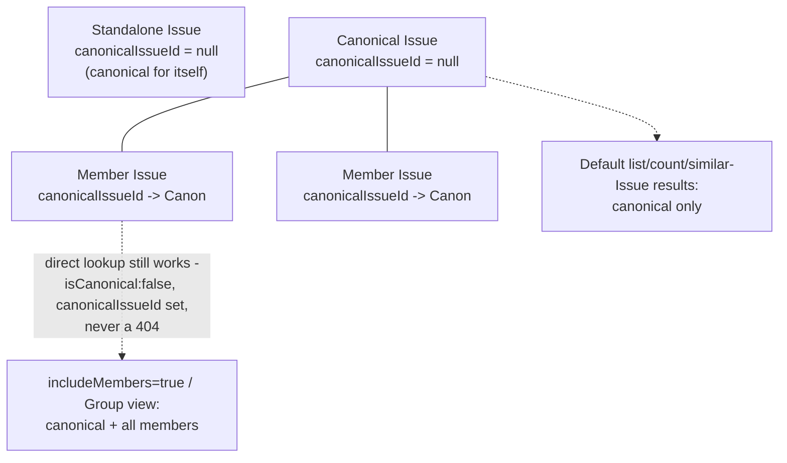

# Issues: canonical grouping, review state, categories, feedback text, deletion

How the Dashboard presents and manages Issues: canonical Issues by default with an audit toggle, the five Admin grouping operations, review states as the only training-eligibility signal (never the legacy `confirmed`), the Company-scoped category catalog with advisory Ollama suggestions, and the Admin-editable feedback text. The Issue text in two languages is in `languages.md`.

Related: the API side of this feature is in [../../../PRECOG_API/docs/features/issues.md](../../../PRECOG_API/docs/features/issues.md).

The text below was moved verbatim from `CLAUDE.md` (Dashboard) on 2026-11-19; dates and "superseded" notes are the original ones. Keep this file up to date with every change to the feature.

### Canonical Issues

Every qualified Issue is retained forever — a member is never deleted, only
its `canonicalIssueId` reference changes. `IssueListPage.tsx` shows
canonical Issues by default (`includeMembers=false`); the explicit toggle
switches to the audit/history view. `IssueDetailPage.tsx`'s Group card shows
the canonical Issue's preserved members with drill-down.

Grouping is **explicit and Admin-controlled** — never inferred from score,
timestamp, aggregation level, similarity, or `GetElbow` (backend `AGENTS.md`:
"Do not infer canonical selection or importance from... any derived
representative-level rule"). Reader may read the Group view for a Device
it's granted; only Admin can group/ungroup/move/reassign. DevicePrincipal
cannot touch Issue management at all.

All five grouping operations have UI: **Group** is Admin-only multi-select
on `IssueListPage.tsx` (checkbox several Issues → a `ConfirmDialog`-based
dialog to pick which one becomes canonical); **Ungroup**, **Move-Group**
("move to another group"), and **Reassign-Canonical** ("make canonical")
live on `IssueDetailPage.tsx`'s Group card, per member, via
`GroupMemberRow`. Move-Group's target is chosen through
`MoveToCanonicalDialog.tsx` — a bounded, searchable Fluent `Combobox`
backed by `Issue_GetIssues` with the current Device and the default
`includeMembers=false`, which returns exactly the canonical-only candidate
set a valid target must be drawn from (the member itself and its current
canonical are excluded client-side). No native `window.prompt` remains
anywhere in this codebase.

### Review states

`PendingReview | ReviewedFault | ReviewedFalsePositive` is the sole
authoritative source of training eligibility (`IssueDto.reviewState`) — the
legacy `confirmed`/`isAnomaly` booleans still exist on the DTO but are an
explicitly lossy derived projection (`ReviewedFalsePositive` and
`PendingReview` both collapse to `confirmed: false`), so this frontend never
reads `confirmed` for anything; every review-state display and every
review-state mutation goes through `reviewState` directly
(`IssueDetailPage.tsx`'s review buttons call `POST /Review` with an explicit
`reviewState`, never the legacy `PUT` path).

Only a human Company Admin may set the review state; Reader is read-only.
Both `ReviewedFault` and `ReviewedFalsePositive` are valid, distinctly
labeled training examples; `PendingReview` is always excluded from training.
A review-state change is an eligibility-changing event — it advances the
Device's (and any actively-sharing target Device's) training generation and
schedules a coalesced retraining request, asynchronously, never
synchronously inside the review HTTP call.

### Categories

Category and review verdict are **separate concepts** — assigning a category
never changes `reviewState`, and vice versa. Categories are a Company-scoped,
extensible catalog (`CategoriesPage.tsx`), never a fixed enum; retiring a
category preserves history rather than deleting it (`useSetIssueCategoryEnabled`,
never a delete endpoint — there isn't one). Ollama may propose one advisory
2–3 word suggestion (`IssueCategorySuggestionDto`); only an Admin's
`accept`/`reject` decision (`useDecideCategorySuggestion`) is ever effective
— requesting or viewing a suggestion never itself triggers retraining
(backend `AGENTS.md`: "Creating, viewing, or regenerating an automatic
category suggestion does not trigger retraining"). Only a human Admin's
*confirmed* category assignment or review-verdict override triggers the
coalesced retraining generation advance.

## Issue feedback text (editable)

The Issue detail page's first card has an Admin-only **Feedback** box (`IssueFeedbackEditor` in `IssueDetailPage.tsx`): the Issue's message, editable independent of the Confirm fault / Mark false positive buttons - before, with or after a review. **Save feedback** sends `PUT /api/Issue/{id}` with **only** `{ message }` (`useUpdateIssue`): it never changes the review state, never touches training eligibility, schedules no retraining, and the legacy `confirmed` / `isAnomaly` fields are never sent. Limit 440 characters (the Issue.Message column; the API does not validate it, so the box refuses longer text and shows a counter). A Reader sees the text read-only. Behaviour worth knowing: while an Issue is **not reviewed** a new automatic analysis may replace the message with a system-generated one; once a verdict is recorded the text is kept (the API skips reviewed Issues when re-analysing). The message is also what the Device shows as the latest Issue text. The box says this itself. Tests: `IssueFeedbackEditor.test.tsx` (PUT carries only the message, Revert, the 440 limit, the hint before/after review).

## Issue list rows name the Sensor (2026-11-19)

A row of the Issues list (`IssueListPage.tsx`) starts with the name of the Sensor the Issue was raised for (`primarySensorId`, resolved through `useSensors`; the external id when the Sensor has no name) before the from - to span: `Vibration X · 2026-11-19 10:00 → 2026-11-19 10:05`. An Issue that is not attributable to one Sensor shows only the span. The same text is in the radio list of the "Group Issues" dialog. The Issue detail chart marks anomalous points larger (yellow warning, red critical, `smart-analytics.md`). Test: `IssueListPage.test.tsx`.

## E-mail sent mark (2026-11-19)

An Issue whose e-mail notification reached at least one person (the API's Issue e-mail, `PRECOG_API/docs/features/issue-email.md`) shows an **E-mail sent** badge with a mail icon (`EmailSentPill`, `src/components/StatusPill.tsx`; icon + text, never color alone) in its row of the Issues list, next to the review state, and in the first card of the Issue detail page. The list has one row layout for every width, so the badge shows on desktop and phone alike. The tooltip, and on the detail page a line under the badges, say when and to how many people: "E-mail sent 2026-11-19 10:06 to 3 recipient(s)" (`emailSentText`, `src/lib/issueEmail.ts`; without the count when the API does not know it). An Issue with no e-mail (switched off, nobody subscribed, every attempt failed, found in the past, or still waiting for its summary) shows nothing.

- Data: `IssueDto.notificationSentAt` (UTC, null = no e-mail) and `IssueDto.emailRecipientCount`, both straight from the API, which reads them with one query per list page. Nothing is worked out in the browser. A "0 recipient(s)" record (nobody to notify) is not a sent e-mail, and the API already returns null for it.
- `emailRecipientCount` is not in `schema.generated.ts` yet (the local API was not running when this was built). `IssueEmailFields` in `src/api/domainTypes.ts` types it until the next `npm run gen:api`.
- Texts in English and Hungarian (`translations.status.ts`): "E-mail sent" / "E-mail elküldve".
- Tests: `IssueListPage.test.tsx` (the mailed Issue has the badge, an unmailed one does not), `src/lib/issueEmail.test.ts` (the sentence in both languages, with and without the count, empty when none was sent).

## Issues are anomaly runs that reach MinIssueScore (2026-11-19, API)

The API's raw-level Issue rule changed (API `docs/features/issues.md` "Raw-level Issues: one anomaly run, its own score"): an Issue's score is the score of ONE anomaly run (it ends after 5 readings without a new anomaly), an Issue is created only when that score reaches the raw policy's MinIssueScore, and it spans the run up to its last positive anomaly. No Dashboard change was needed: the Issue list and detail show what the API stores. Two old defects made Issues that should not exist (a one-point run ending on a batch boundary; separate runs glued into one Issue spanning days); a Recalc removes them and rebuilds the unreviewed Issues with the new rule. The Recalc dialog now says the values are evaluated "in time order, in batches" (the API evaluates a Recalc in the live analysis's batches since the same day), and the progress line's phase texts are translated ("evaluating the values in batches").

## The Issue detail chart opens large (2026-11-20)

The Telemetry chart of the Issue detail page (`IssueDetailPage.tsx`) is an `EnlargeableTelemetryChart`, like the Smart Analytics charts: clicking the chart (not its legend) or its Enlarge button (the keyboard route) opens it in a large modal window with a full date-time axis, an enlarged hover marker and, when the Sensor has a description, the "?" description panel. The window's title is the Sensor's name. Anomalous points are drawn large (yellow warning, red critical) on both charts. Test: `IssueDetailPage.test.tsx`.

## Issue score under the chart (2026-11-20)

The Issue detail page writes the **Issue score** under its Telemetry chart (`issue.score`, test id `issue-score`): the sum of the anomaly values (1 warning, 2 critical) the analysis stored for the Issue's Sensor inside the Issue's measured range - the number the Sensor's Min issue score is compared with when an Issue qualifies. The API calculates it when it reads one Issue (`GET /api/Issue/{issueId}` only; `IssueDto.score`, `Services/IssueScore.cs`, nothing stored, so it works for existing Issues); lists and the group read leave it null, and so does an Issue without a Sensor or of a periodic Sensor - then the line is not shown. The Dashboard only displays it, it never adds anomaly values up itself. Test: `IssueDetailPage.test.tsx`.

## An Issue of an aggregation level shows that level's values (2026-11-20)

`IssueDto.sourceAggregationPolicyId` (API, added 2026-11-20) names the aggregation level that raised an Issue (null = the raw readings or created by hand). The Issue detail chart (`IssueDetailPage.tsx`) used to draw the raw readings of the Issue's period for every Issue, so a daily-level Issue showed something else than what triggered it. Now, when the policy is a level the Sensor still has (`levelsOfSensor` of the Device-wide policy list), the chart draws THAT level's buckets (`useAggregatedPoints`, from 30 buckets before the Issue to 7 after it, up to now - context around it), with the level in the series label, the level's warm-up on the maintenance markers and the note "Raised by the aggregation level ...". The raw read (`useTelemetryPeriodRange(enabled: false)`) is skipped. Anomalous buckets are marked yellow / red like raw readings (`bucketToPoint`). The Issue **score** of such an Issue is the sum of the anomaly values of the level's buckets in its range. If the level was deleted or switched off, the chart falls back to the raw readings. Tests: `IssueDetailPage.test.tsx`.

## The Issue chart draws the full reference set (2026-11-20)

The Telemetry chart of the Issue detail page (and its enlarged window) uses `detailedLimits`, like Smart Analytics and the enlarged Live chart: Target and Tolerance (where the API has a setpoint) plus UCL3 / UCL2 / LCL2 / LCL3 with the two shaded bands, for a raw Issue and for the buckets of a level's Issue alike. Before it drew only UCL3 / LCL3. Test: `IssueDetailPage.test.tsx`.

## The Issue chart names the aggregation it shows (2026-11-20)

Under "Telemetry" the Issue detail page always writes **Aggregation shown: ...** (test id `issue-chart-level`): the level that raised the Issue (e.g. "1 day · 95th percentile", with a note that the chart shows that level's values) or "Raw readings". It appears only once the level is known, so it never says "Raw readings" while the policy list is still loading. Test: `IssueDetailPage.test.tsx`.
