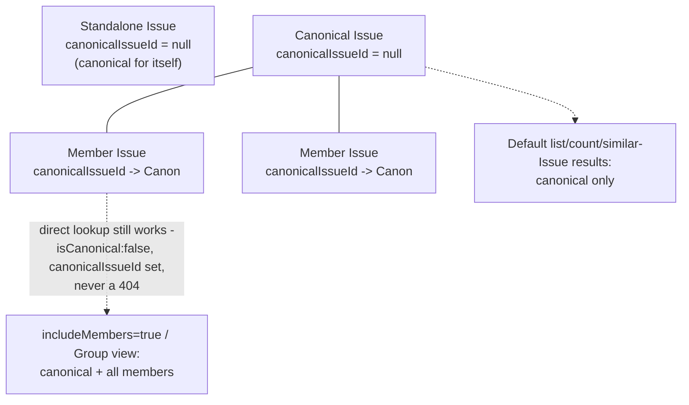

# Issues: canonical grouping, review state, categories, feedback text, deletion

How the Dashboard presents and manages Issues: canonical Issues by default with an audit toggle, the five Admin grouping operations, review states as the only training-eligibility signal (never the legacy `confirmed`), the Company-scoped category catalog with advisory Ollama suggestions, and the Admin-editable feedback text. The Issue text in two languages is in `languages.md`.

Related: the API side of this feature is in [../../../PRECOG_API/docs/features/issues.md](../../../PRECOG_API/docs/features/issues.md).

The text below was moved verbatim from `CLAUDE.md` (Dashboard) on 2026-11-19; dates and "superseded" notes are the original ones. Keep this file up to date with every change to the feature.

### Canonical Issues

Every qualified Issue is retained forever — a member is never deleted, only
its `canonicalIssueId` reference changes. `IssueListPage.tsx` shows
canonical Issues by default (`includeMembers=false`); the explicit toggle
switches to the audit/history view. `IssueDetailPage.tsx`'s Group card shows
the canonical Issue's preserved members with drill-down.

Grouping is **explicit and Admin-controlled** — never inferred from score,
timestamp, aggregation level, similarity, or `GetElbow` (backend `AGENTS.md`:
"Do not infer canonical selection or importance from... any derived
representative-level rule"). Reader may read the Group view for a Device
it's granted; only Admin can group/ungroup/move/reassign. DevicePrincipal
cannot touch Issue management at all.

All five grouping operations have UI: **Group** is Admin-only multi-select
on `IssueListPage.tsx` (checkbox several Issues → a `ConfirmDialog`-based
dialog to pick which one becomes canonical); **Ungroup**, **Move-Group**
("move to another group"), and **Reassign-Canonical** ("make canonical")
live on `IssueDetailPage.tsx`'s Group card, per member, via
`GroupMemberRow`. Move-Group's target is chosen through
`MoveToCanonicalDialog.tsx` — a bounded, searchable Fluent `Combobox`
backed by `Issue_GetIssues` with the current Device and the default
`includeMembers=false`, which returns exactly the canonical-only candidate
set a valid target must be drawn from (the member itself and its current
canonical are excluded client-side). No native `window.prompt` remains
anywhere in this codebase.

### Review states

`PendingReview | ReviewedFault | ReviewedFalsePositive` is the sole
authoritative source of training eligibility (`IssueDto.reviewState`) — the
legacy `confirmed`/`isAnomaly` booleans still exist on the DTO but are an
explicitly lossy derived projection (`ReviewedFalsePositive` and
`PendingReview` both collapse to `confirmed: false`), so this frontend never
reads `confirmed` for anything; every review-state display and every
review-state mutation goes through `reviewState` directly
(`IssueDetailPage.tsx`'s review buttons call `POST /Review` with an explicit
`reviewState`, never the legacy `PUT` path).

Only a human Company Admin may set the review state; Reader is read-only.
Both `ReviewedFault` and `ReviewedFalsePositive` are valid, distinctly
labeled training examples; `PendingReview` is always excluded from training.
A review-state change is an eligibility-changing event — it advances the
Device's (and any actively-sharing target Device's) training generation and
schedules a coalesced retraining request, asynchronously, never
synchronously inside the review HTTP call.

### Categories

Category and review verdict are **separate concepts** — assigning a category
never changes `reviewState`, and vice versa. Categories are a Company-scoped,
extensible catalog (`CategoriesPage.tsx`), never a fixed enum; retiring a
category preserves history rather than deleting it (`useSetIssueCategoryEnabled`,
never a delete endpoint — there isn't one). Ollama may propose one advisory
2–3 word suggestion (`IssueCategorySuggestionDto`); only an Admin's
`accept`/`reject` decision (`useDecideCategorySuggestion`) is ever effective
— requesting or viewing a suggestion never itself triggers retraining
(backend `AGENTS.md`: "Creating, viewing, or regenerating an automatic
category suggestion does not trigger retraining"). Only a human Admin's
*confirmed* category assignment or review-verdict override triggers the
coalesced retraining generation advance.

## Issue feedback text (editable)

The Issue detail page's first card has an Admin-only **Feedback** box (`IssueFeedbackEditor` in `IssueDetailPage.tsx`): the Issue's message, editable independent of the Confirm fault / Mark false positive buttons - before, with or after a review. **Save feedback** sends `PUT /api/Issue/{id}` with **only** `{ message }` (`useUpdateIssue`): it never changes the review state, never touches training eligibility, schedules no retraining, and the legacy `confirmed` / `isAnomaly` fields are never sent. Limit 440 characters (the Issue.Message column; the API does not validate it, so the box refuses longer text and shows a counter). A Reader sees the text read-only. Behaviour worth knowing: while an Issue is **not reviewed** a new automatic analysis may replace the message with a system-generated one; once a verdict is recorded the text is kept (the API skips reviewed Issues when re-analysing). The message is also what the Device shows as the latest Issue text. The box says this itself. Tests: `IssueFeedbackEditor.test.tsx` (PUT carries only the message, Revert, the 440 limit, the hint before/after review).
